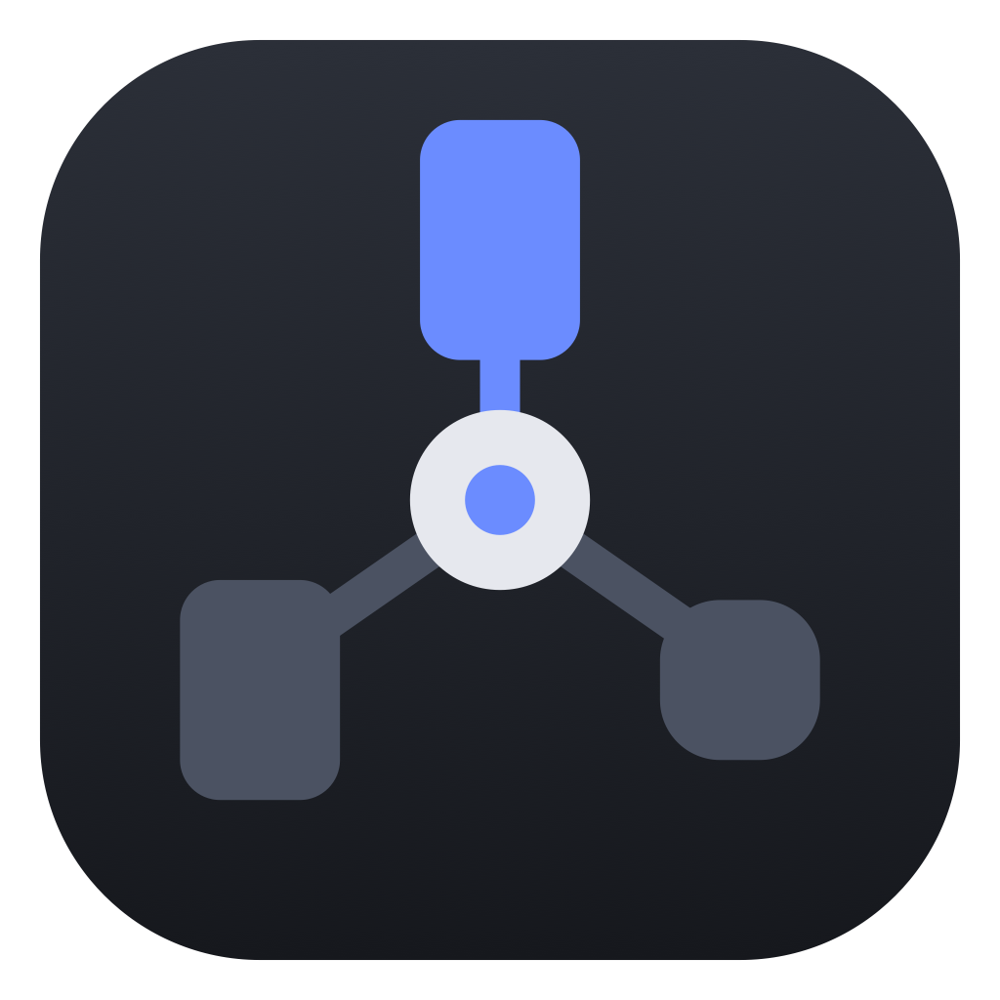

# Claude Device Manager



A macOS desktop app that shares your connected Android devices between multiple Claude Code sessions.

When several Claude sessions test on the same phone at once, they fight over the screen and get stuck. While the app is running, every session has to check in before it touches a device. It gets a free device of the right kind, or it waits in a queue. You can watch all of this and step in from the app.

## What it does

- **One session per device.** A session (or any one of its subagents) holds a device until it's done. Every Bash command from that session is pinned to its device with `ANDROID_SERIAL`, including Gradle tasks and wrapper scripts.
- **The right kind of device.** Devices are auto-detected as phone or watch, and you can override that. A session asks for `phone`, `watch`, `phone,watch` or `any`.
- **A queue.** If nothing fits, the session pauses until a device frees up. It doesn't improvise or give up.
- **Automatic release.** A device is released after 15 minutes without an `adb` or Gradle command, or 5 minutes once the session has moved on to editing code. Both times can be changed. A device that drops off USB or Wi-Fi stays held.
- **You stay in control.** From the app you can:
  - release a device, or release it and block that session;
  - mark a device "don't use";
  - change a device's category;
  - reorder the queue, or hand a device to a waiting session right away.
- **Nothing happens when it's closed.** The app adds its Claude Code hooks, the `cdm` command and a `CLAUDE.md` note when it starts, and removes them when it quits. With the app closed, Claude works exactly as before.

## Requirements

- macOS (Linux should work but isn't tested).
- JDK 21 to build.
- `adb` on your `PATH`.
- Claude Code.

JetBrains Runtime 25 is downloaded automatically the first time you run or package the app. The custom title bar needs it.

## Install

Download the installer for your OS from the [latest release](https://github.com/jakepurple13/ClaudeDeviceManager/releases/latest): `.dmg` (macOS), `-nsis.exe` (Windows), `.deb` or `.AppImage` (Linux).

The builds are unsigned. On macOS the first launch is blocked: open System Settings → Privacy & Security and click **Open Anyway**. On Windows, SmartScreen asks once.

After that the app updates itself. It checks GitHub releases at launch and every 6 hours, and Settings → Updates has **Check now**. When an update is found, a banner offers **Download**, then **Restart to update**. Nothing restarts on its own, because a restart releases every held device.

## Run it

```bash
./gradlew :composeApp:run
```

Build the installers for the current OS:

```bash
./gradlew :composeApp:packageDistributionForCurrentOS -PappVersion=1.2.0
```

Run the tests:

```bash
./gradlew :composeApp:jvmTest
```

## How it works

```
Claude Code session ──(http hooks)──▶ Claude Device Manager ◀── adb (device scan)
        │                                   ▲
        └── cdm acquire / release ──────────┘  (local HTTP on 127.0.0.1:47823)
```

1. **On startup** the app binds `127.0.0.1:47823` and writes the port to `~/.claude-device-manager/port`. It then installs three things:
   - Four `http` hooks in `~/.claude/settings.json`: `PreToolUse` for Bash, `PreToolUse` for file edits, `SubagentStop` and `SessionEnd`. Your settings file is backed up first, and your other hooks are left alone.
   - `~/.local/bin/cdm`.
   - A short marked block in `~/.claude/CLAUDE.md` telling Claude to run `cdm acquire` before device work.
2. **Before every Bash command** the hook asks the app what to do:
   - If the session holds a device, the command is rewritten to `export ANDROID_SERIAL=<serial>; <command>`.
   - A device command from a session with no device grabs a free one, or is denied with a message telling Claude to run `cdm acquire`.
   - Commands that would reach someone else's device (`-s <other>`, `ANDROID_SERIAL=<other>`, `adb kill-server`, …) are denied.
3. **Subagents are separate holders.** Each one is identified by session ID plus agent ID, and gets its own device or queue spot.
4. **On quit** (window close, Cmd+Q or SIGTERM) the app removes only its own hook entries, the `CLAUDE.md` block and `cdm`. A crash leaves the entries behind. They fail open (Claude carries on as normal) and are cleaned up the next time the app starts.

> Claude Code reads hooks and `CLAUDE.md` when a session **starts**. Start (or restart) sessions after the app is running for them to use it.

### The `cdm` command

Claude runs this itself through its Bash tool, which adds the session identity:

```bash
cdm acquire --category phone   # wait for a phone (also: watch, phone,watch, any)
cdm release                    # give the device back
cdm status                     # what this session holds, or its queue position
```

`cdm acquire` waits up to about 110 seconds, which keeps it under Claude Code's default 2-minute Bash timeout. If it's still queued, it says so and Claude runs it again. If the app isn't running, it prints `Device Manager not running; proceeding without a device lock.` and exits 0.

## Permissions

Rewriting a command stops Claude Code from matching it against your allow rules. You choose how pinned commands are approved in **Settings → Pinned commands**:

| Mode | Behavior |
|---|---|
| **Follow my Claude permission rules** (default) | The app checks your rules against the *original* command, from your user, project and managed settings files. It approves the command only if your rules would have. Otherwise you get the normal prompt. It's deliberately conservative: anything with `sudo`, env assignments, globs, `$` expansion or paths outside the project prompts. |
| **Always allow** | Pinned commands run without a prompt. This skips your allow and ask rules and auto mode's check. Your deny rules still apply. |
| **Always ask** | Every pinned command needs your approval. |

Commands that are only `cdm` are always allowed.

## The app

<!-- Screens follow the mockups in .superpowers/brainstorm (git-ignored). -->

- **Overview:** counts, devices with their holders and timers, who's up next, and recent activity.
- **Devices:** detail for each device, including category, holder, recent commands, release, release and block, and "don't use".
- **Queue:** drag to reorder, see why a session is waiting, hand it a device now, or remove it.
- **Sessions:** every session with its subagents, and their state. Blocked sessions can be unblocked here.
- **Projects:** a default device category for each project.
- **Settings:** port, release timers, pinned-command permissions, install status with Repair, and the `CLAUDE.md` snippet.

## Troubleshooting

- **A session is denied with "You're blocked" while the device is free.** Someone used *Release + block* on it. Blocks last across restarts. Unblock it under **Sessions**.
- **A session ignores the app.** It was started before the app. Restart the session.
- **"Port 47823 is in use".** Another copy of the app is probably running. Close it, or change the port in Settings. The integration is only installed after the server binds.
- **Leftover backups.** `~/.claude/settings.json.cdm-backup-*` files are kept, up to the newest 5. They're safe to delete.

## Tech stack

Kotlin 2.4 · Compose Multiplatform (desktop/JVM) · Navigation 3 (list-detail scenes) · Room 3 (bundled SQLite) · Koin · Ktor server (CIO) · Jewel decorated window · reorderable.

## Project layout

```
composeApp/src/jvmMain/kotlin/com/programmersbox/cdm/
  core/       command classifier, allocator (holds, queue, timers), models
  service/    DeviceManagerService, hook decisions, permission mirror
  server/     Ktor routes for hooks and cdm, server lifecycle
  install/    settings.json / cdm / CLAUDE.md install and uninstall
  devices/    adb device tracking
  data/       Room database and repositories
  ui/         Navigation 3 shell, screens, ViewModels, Jewel window
composeApp/src/jvmMain/resources/cdm    the cdm script
docs/superpowers/                       design spec, implementation plan, hook findings
```

## Development notes

- `CDM_START_ROUTE=devices:<serial>` (or `queue:<holder>`, or a bare section name) opens the app on that screen. It's useful for screenshots.
- `spikes/hook-echo.py` is a tiny hook echo server for inspecting real Claude Code hook payloads.
- Tests never touch your real `~/.claude`. Running the app does: it installs and uninstalls as described above.
- `CDM_UPDATE_URL=http://127.0.0.1:8770` makes a packaged build read updates from a local folder (served with `python3 -m http.server 8770 --bind 127.0.0.1`) holding `latest-mac.yml` and the ZIP and blockmap from `composeApp/build/compose/binaries/main/zip`, instead of GitHub.

## Releasing

Push a tag: `git tag -a v1.2.0 -m v1.2.0 && git push origin v1.2.0`. `.github/workflows/release.yml` runs the tests, builds the installers on macOS, Windows and Linux, writes the `latest-*.yml` update files, and publishes the GitHub release. Each tag must be a higher version than the last, or installed apps won't offer it. A `-beta.N` or `-alpha.N` tag is published as a pre-release on that channel.
